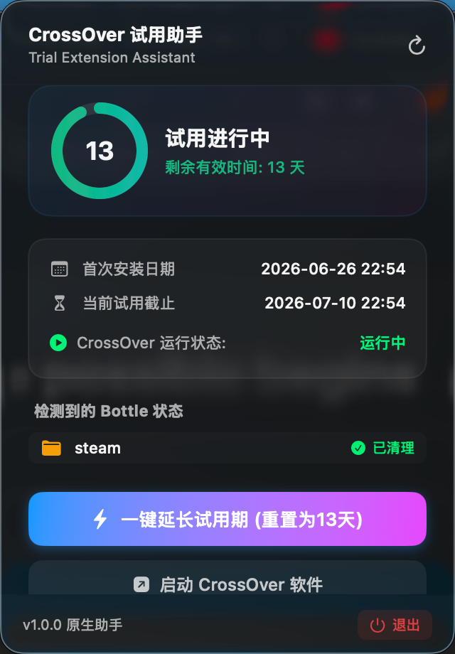
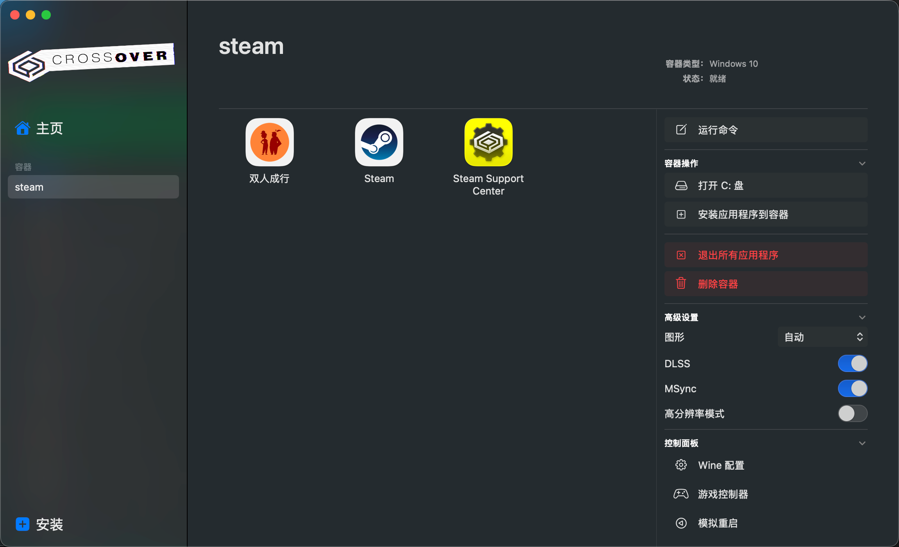

# CrossOverUnlimitedtrial

## CrossOver 试用期延长助手 (CrossOver Helper)

一款专为 macOS 用户开发的原生顶部菜单栏（Status Bar）小助手。它可以自动监控 CrossOver 软件的试用期剩余时间，并在试用期满或需要时，通过一键重置为您再次提供 13 天试用时间，实现无限延长试用。

### 软件预览

### 核心功能

1. 顶部菜单栏实时显示
   - 启动后常驻在 macOS 顶部菜单栏右侧，以极低功耗在后台监控试用状态。
   - 实时显示当前状态，如 `⏳ 13天`、`⏳ 3天` 或 `⚠️ 已过期`，无需打开主程序即可一眼看清到期进度。

2. 高级感交互面板 (Premium Glassmorphic UI)
   - 点击菜单栏图标会展开一个遵循 macOS 设计规范的毛玻璃半透明浮窗面板，显示精致的环形进度条和详细的时间数据。
   - 动态卡片显示 CrossOver 首次运行时间（FirstRunDate）和当前周期的具体截止日期。

3. 一键延长试用期
   - 自动检测并提示/关闭当前处于运行状态的 CrossOver 进程，防止文件占用冲突。

4. 一键快捷联动
   - 提供快速“启动 CrossOver 软件”按钮与“刷新”按钮，方便重置后迅速开机测试。
   - 提供一键“退出”安全退出后台进程。

### 系统要求

- macOS 13.0 (Ventura) 及以上系统
- 原生支持 Apple Silicon (M1/M2/M3/M4 系列芯片) 及 Intel 芯片

### 安装与运行

#### 快速安装（直接运行）

1. 下载或在工作区双击解压 [CrossOverHelper.zip](file:///Users/lcl101/workspace/corssover_data/CrossOverHelper.zip)。
2. 将解压出的 `CrossOverHelper.app` 拖入您的 `/Applications`（应用程序）文件夹中。
3. 双击运行即可。
